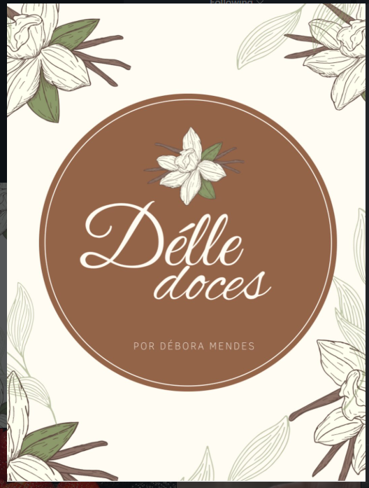

<div align="center">



# 🍰 Délle Doces

### Cardápio digital feito com carinho, do primeiro clique ao pedido. ♡

Uma experiência doce e intuitiva para explorar produtos, montar o carrinho e enviar o pedido pelo WhatsApp — em qualquer dispositivo.

<p>
  <a href="https://tiosambr.github.io/D-lleDoces/"></a>
  <a href="https://www.instagram.com/delledoces_d/"></a>
</p>

<p>
  
  
  
  
  
</p>

**[🌐 Acessar o cardápio](https://tiosambr.github.io/D-lleDoces/)** · **[📸 Instagram](https://www.instagram.com/delledoces_d/)** · **[💻 Repositório](https://github.com/TIOSAMBR/D-lleDoces)**

</div>

---

## ✨ Sobre o projeto

O **Délle Doces** é um cardápio online desenvolvido para apresentar os doces artesanais da marca **Délle Doces — por Débora Mendes** de forma elegante, prática e acessível.

O cliente explora os produtos, confere fotos e preços, escolhe suas quantidades e monta o pedido. Ao finalizar, o site prepara uma mensagem com os itens, o total, o nome e as observações do cliente, pronta para ser enviada pelo **WhatsApp**.

Tudo isso com uma identidade visual inspirada na confeitaria: tons de **creme, marrom, bege e verde**, detalhes delicados e fotos em destaque.

## 📱 Preview do cardápio

<div align="center">
  
  &nbsp;
  
</div>

<p align="center"><sub>Capturas reais do projeto · Desktop e mobile</sub></p>

## 💚 Funcionalidades

| Funcionalidade | Como funciona |
|:--|:--|
| 🧁 **Cardápio com categorias** | Filtre por Todos, Bolos, Doces, Festa e Combos. |
| 📷 **Fotos completas** | Imagens exibidas sem cortes, preservando suas proporções. |
| 🔍 **Ampliar foto** | Clique em **Ver foto** para visualizar o produto em tamanho maior. |
| 🟢 **Disponibilidade de produtos** | Selo de disponível ou indisponível, com bloqueio de compra quando necessário. |
| 🛒 **Carrinho interativo** | Adicione produtos e ajuste as quantidades. |
| 💰 **Cálculo do pedido** | Total atualizado conforme os itens selecionados. |
| 💬 **Pedidos pelo WhatsApp** | Geração de mensagem com nome, produtos, quantidades, valores e observações. |
| 📱 **Layout responsivo** | Experiência adaptada para computadores e celulares. |
| 🌐 **Hospedagem simples** | Site estático que pode ser publicado no GitHub Pages. |

## 🧭 Como funciona um pedido?

```text
🍰 Explorar o cardápio
       ↓
🧁 Escolher produtos disponíveis
       ↓
🛒 Ajustar o carrinho
       ↓
✍️ Informar nome e observações (opcional)
       ↓
💬 Abrir mensagem pronta no WhatsApp
       ↓
💚 Enviar o pedido para a Délle Doces
```

> **Importante:** o site monta a mensagem e abre o WhatsApp. O envio só acontece quando o cliente confirma a mensagem no aplicativo. Não há checkout com pagamento online.

## 🛠️ Tecnologias

- **HTML5:** estrutura semântica da interface.
- **CSS3:** estilos, cores, organização dos cards e responsividade.
- **JavaScript (Vanilla JS):** produtos, categorias, disponibilidade, carrinho, fotos ampliadas e pedido pelo WhatsApp.
- **Google Fonts:** tipografias *DM Sans* e *Great Vibes*.
- **GitHub Pages:** hospedagem gratuita do site estático.

**Sem framework, sem instalação de dependências e sem etapa de compilação.**

## 🚀 Executar localmente

1. Baixe este repositório pelo GitHub (**Code → Download ZIP**) ou clone-o:

   ```bash
   git clone https://github.com/TIOSAMBR/D-lleDoces.git
   ```

2. Acesse a pasta do projeto:

   ```bash
   cd D-lleDoces
   ```

3. Abra `index.html` no navegador. Se preferir, utilize a extensão **Live Server** no VS Code.

Pronto! O cardápio pode ser utilizado sem banco de dados ou servidor de aplicação.

## ⚙️ Personalização

### 🟢 1. Definir se um produto está disponível

No arquivo `script.js`, cada item da lista `products` possui a propriedade `available`:

```js
available: true,  // Disponível: pode entrar no pedido
available: false, // Indisponível: aparece no cardápio, mas não pode ser comprado
```

Quando um produto fica **indisponível**, o site exibe um selo de aviso, suaviza sua foto e desativa o botão de adicionar. Ele também é impedido de entrar no pedido.

### 🧁 2. Adicionar ou editar produtos

No início do `script.js`, localize o array `products`. Um novo item pode seguir este modelo:

```js
{
    id: 13, // Utilize um ID único
    name: "Brigadeiro gourmet",
    description: "Brigadeiro artesanal com chocolate.",
    price: 5.00,
    available: true,
    category: "doces",
    categoryName: "Doces",
    image: "brigadeiro.jpg",
    emoji: "🍫"
}
```

Salve a foto `brigadeiro.jpg` na mesma pasta do `index.html`, ou indique outro caminho relativo em `image` (por exemplo, `img/brigadeiro.jpg`). Verifique se o nome e a extensão do arquivo correspondem exatamente aos informados no código.

Categorias usadas no projeto: `bolos`, `doces`, `festa` e `combos`.

### 💬 3. Alterar o WhatsApp de recebimento

Altere a constante `WHATSAPP`, no começo do arquivo `script.js`:

```js
const WHATSAPP = "55DDDNUMERO";
```

Use o código do país **55**, o DDD e o número, somente com algarismos, sem espaços ou sinais.

### 🎨 4. Modificar a identidade visual

As principais cores estão reunidas nas variáveis `:root` de `style.css`:

```css
:root {
    --creme: #F8F3E7;
    --marrom: #9A694B;
    --marrom-dark: #5D4033;
    --verde: #737C55;
    --bege: #D8C5AA;
}
```

A imagem da marca exibida no topo está em `logo-referencia.png`.

## 🗂️ Estrutura do projeto

```text
D-lleDoces/
├── index.html             # Estrutura do cardápio
├── style.css              # Estilos, cores e responsividade
├── script.js              # Produtos, carrinho e integração WhatsApp
├── logo-referencia.png    # Logotipo da Délle Doces
├── *.jpg / *.jpeg         # Fotos utilizadas pelos produtos
├── img/                   # Imagens adicionais
├── docs/
│   ├── preview-desktop.png
│   └── preview-mobile.png
└── README.md              # Documentação do projeto
```

## ☁️ Publicar no GitHub Pages

1. Envie os arquivos do projeto para seu repositório no GitHub.
2. Acesse **Settings → Pages**.
3. Em **Build and deployment**, escolha **Deploy from a branch**.
4. Selecione a branch `main` e a pasta `/ (root)`, e salve.
5. Acesse o endereço publicado quando o GitHub Pages finalizar a implantação.

> Ao alterar produtos, preços, fotos ou disponibilidade, publique o `script.js` e os demais arquivos modificados no repositório para que todos os visitantes recebam a versão atualizada. Em alguns casos, pode ser necessário atualizar a página para sair do cache do navegador.

## ❓ Perguntas frequentes

<details>
<summary><strong>Existe um painel administrativo para ativar e desativar os produtos?</strong></summary>

Não. A disponibilidade é configurada pelo campo `available` de cada produto no `script.js`. Para mudar o status para todos os clientes, é preciso publicar o arquivo atualizado. Um painel com alterações em tempo real exigiria um serviço de backend ou banco de dados compartilhado.

</details>

<details>
<summary><strong>O site guarda os pedidos automaticamente?</strong></summary>

Não. O carrinho funciona na página e a finalização abre uma mensagem no WhatsApp. Este projeto não possui banco de dados para armazenar pedidos.

</details>

<details>
<summary><strong>Por que a foto de um produto não aparece?</strong></summary>

Verifique o caminho da propriedade `image`, o nome do arquivo e a extensão (`.jpg`, `.jpeg`, `.png` etc.). Em hospedagens como GitHub Pages, letras maiúsculas e minúsculas no caminho fazem diferença.

</details>

---

<div align="center">

### 🍰 Délle Doces

*Doces feitos com carinho para deixar seus momentos ainda mais especiais.*

**[Ver cardápio](https://tiosambr.github.io/D-lleDoces/)** · **[Instagram @delledoces_d](https://www.instagram.com/delledoces_d/)**

<sub>Desenvolvimento web: <a href="https://github.com/TIOSAMBR">TIOSAMBR</a> · Feito com 🤎</sub>

</div>
